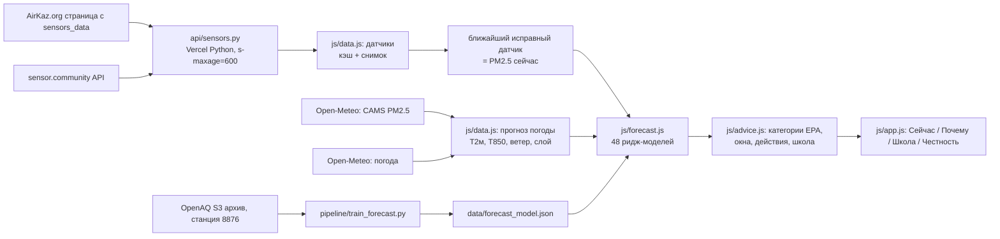

**Прототип: https://taza-tynys.vercel.app**

# Таза Тыныс — воздух у школы: сейчас и на 48 часов

**Кейс 1 «Экология Казахстана», Órleu Hack 2026.** Завуч выбирает школу на карте и видит реальный PM2.5 с ближайшего датчика (а не модельную цифру), прогноз на 48 часов от нашей модели, решение «физкультура на улице или в зале» по каждому уроку и готовое объявление для родителей на казахском и русском.

PWA без ключей: статический сайт + одна серверная функция `api/sensors.py`. Офлайн показывает последние сохранённые данные.

## Проблема

- В смоге Алматы **34%** загрязнения даёт сжигание угля и биомассы: **18%** ТЭЦ и котельные, **16%** отопление частного сектора; **32%** — дорожная пыль (цифры из кейса, Bizmedia).
- Популярные прогнозы опираются на глобальную модель Copernicus CAMS (сетка около 40 км). Она не видит смог в котловине: на реальной станции Алматы в 201 часе, когда та показывала больше 100 мкг/м³ (медиана 127), CAMS показывал медиану **40 — в 3,2 раза меньше** (`evals/forecast_report.md`).
- У школ грязно именно в учебное время: по оценке фонда Almaty Air Initiative, средний PM2.5 у **352 школ** Алматы за учебный сезон 2025–26 — **43 мкг/м³**, и **76 из 157** учебных дней были выше казахстанского суточного норматива (в пересказе СМИ: [Kursiv, 29.05.2026](https://kz.kursiv.media/2026-05-29/assm-423-sigarety-v-god-deti-zametno-teryayut-iq-iz-za-smoga-v-almaty/); полный отчёт фонда не опубликован).
- **Правила для урока нет.** Акиматы могут переводить школы на дистанционку только при НМУ 2–3 степени и превышении ПДК больше чем в 3 раза; сенатор отметил, что правила Минпросвещения не описывают, как школам действовать при сильном загрязнении ([Tengrinews, 01.12.2025](https://tengrinews.kz/tengri-education/premer-otvetil-vopros-perevode-shkolnikov-distantsionku-iz-586973/)). Завуч каждое утро решает «физкультура на улице или в зале» на глаз, а родители узнают о смоге из чатов.

## Что это и для кого

| Кому | Что получает | Экран |
|---|---|---|
| **Завуч (пользователь №1)** | Смена и расписание звонков (редактируются, сохраняются), отметка уроков физкультуры, решение «на улице / облегчённо / в зале» с причиной по категории US EPA AQI, объявление для родителей на kk и ru с копированием | «Школа» |
| Завуч, семьи | Реальный PM2.5 у выбранной точки (ближайший живой датчик) и решение по физкультуре на этот час, медиана по городу, сравнение «датчик показывает в N раз больше или меньше, чем модель CAMS в этой точке», прогноз на 48 ч, окна чистого воздуха, 3 действия на сейчас для профиля «обычный» или «чувствительная группа» | «Сейчас» |
| Все | Почему такой прогноз: инверсия (на 1,5 км теплее, чем у земли), ветер, слой перемешивания, вклад каждого признака | «Почему» |
| Частный сектор | Карточка «растопка сверху» с цифрой из рецензируемого исследования | «Почему» |
| Жюри и скептики | Ошибка нашего прогноза против «будет как сейчас» и CAMS, малая выборка на живых датчиках, источники и ограничения | «Честность» |

## Польза

- **Масштаб:** в Алматы **360 школ** и **357 222 ученика** (акимат Алматы, итоги 2025–26 уч. года: [gov.kz](https://www.gov.kz/memleket/entities/almaty/press/news/details/1227828?lang=ru)). Физкультура по типовому учебному плану — **3 часа в неделю** в 1–9 классах (приказ МП РК № 365 от 12.08.2022: [adilet](https://adilet.zan.kz/rus/docs/V2200029136); 10–11 классы не сверяли) → около **1,07 млн ученико-уроков физкультуры в неделю** (наш расчёт: 357 222 × 3, верхняя оценка — часть учеников старше 9 класса).
- **Официальных постов мало:** 16 постов Казгидромета в Алматы ([акимат, 27.11.2025](https://www.gov.kz/memleket/entities/almaty/press/news/details/1114325?lang=ru)) — около **1 поста на 22 школы** (наш расчёт). Поэтому мы берём ближайший живой датчик и честно подписываем, откуда цифра.
- **Прецеденты есть, решения на урок — нет.** В США программа EPA Air Quality Flag: школы меняют физкультуру по цвету флага AQI, **700+ школ в 12 штатах** ([вебинар EPA, 2012](https://19january2021snapshot.epa.gov/sites/static/files/2020-10/documents/flagprogram.pdf); свежего числа нет). В Усть-Каменогорске в октябре 2025 года **66 школ** перевели на дистанционку из-за смога, а 02.02.2026 утвердили регламент школ при НМУ ([Kazinform](https://www.inform.kz/ru/pravila-distantsionki-dlya-shkol-pri-nmu-utverdili-v-ust-kamenogorske-fb1eed)) — но это рычаг «вся школа», а не «этот урок». Таза Тыныс закрывает именно урок.

Подробная доказательная база с надёжностью каждого источника и списком того, что не нашли: `docs/EVIDENCE.md`.

## Кейс → решение

| Требование кейса | Решение | Статус |
|---|---|---|
| «помогает людям жить с уже существующими экологическими проблемами» | Реальные датчики вместо модели, прогноз на 48 ч, режим завуча с объявлением родителям | готово |
| «снижает вред для природы» | Карточка «растопка сверху» для частного сектора (16% смога), с источником | дополнительно |
| «Сферу, регион и пользователя команда выбирает сама» | Воздух, Алматы; завуч школы, семьи | готово |

## Демо за 90 секунд

Живые данные поздней осенью чистые, поэтому для показа смога есть зимний пример из архива: кнопка **«Зимний пример: смог 6 февраля 2025»** или `index.html?demo=winter`.

1. **Карта датчиков** («Сейчас»): цветные точки — живые датчики AirKaz и sensor.community, серые — молчат. Нажать на карту или выбрать район — это точка школы.
2. **«У вас сейчас N, модель CAMS в этой точке — M»**: в зимнем примере станция показывает **125 мкг/м³**, CAMS — **41**: «датчик показывает в 3 раза больше, чем модель CAMS». Сразу под цифрой — «Физкультура в этот час: в зале».
   Там же проверка на этом эпизоде, посчитанная из данных: модель **занижает пик** (до 151 при факте до 223 мкг/м³; средняя ошибка за 48 ч 55 против 53 у «будет как сейчас»), **но решение верное — в зал**: решение «в зал или нет» совпало с фактом в 13 из 13 уроков. Честная оговорка: в этом эпизоде весь день грязный, поэтому «все в зал» — лёгкий случай; решение берётся по прогнозу модели (датчик «сейчас» подмешивается только к ближайшим 3 часам), а не по сегодняшнему датчику.
3. **Лента 48 часов**: прогноз нашей модели по категориям EPA, зелёные точки — окна чистого воздуха; в зимнем примере серые точки показывают, что станция измерила на самом деле.
4. **«Почему»** → «Худший час прогноза»: инверсия +6,7 °C (на высоте 1,5 км теплее, чем у земли — «крышка»), ветер 1,3 м/с, слой перемешивания около 65 м; полоски вклада признаков.
5. **«Школа»**: 1 смена, физкультура 3-м уроком → «в зале: прогноз до 141 мкг/м³ (очень вредно)». Отметить ещё урок, открыть «Изменить расписание звонков». Объявление на русском и казахском, кнопки «Скопировать» и «Отправить» (Web Share, на ПК — копирование); класс, школа и подпись вводятся в настройках и сохраняются.
6. **«Честность»**: MAE 17,6 против 23,1 («будет как сейчас») и 22,4 (CAMS); в сильный смог модель ошибается сильнее, чем persistence, — сказано прямо. Рядом — таблица правил и сравнение при одинаковой доле уроков в зале.

Вкладки открываются по ссылке: `#today`, `#why`, `#school`, `#honest` (или `#honesty`).

## Запуск

```bash
cd projects/taza-tynys
python3 scripts/dev_server.py 8000   # http://localhost:8000 — статика + /api/sensors (как на Vercel)
```

`python3 -m http.server` тоже работает: без `/api/sensors` приложение берёт снимок `data/sensors_snapshot.json` (реальный, подписан датой). На Vercel `api/sensors.py` — Python serverless-функция, ответ кэшируется (`s-maxage=600`).

Проверки:

```bash
python3 scripts/check.py           # данные, кэш sw.js, внешние URL: клиент — только Open-Meteo, функция — только AirKaz и sensor.community
python3 tests/test_forecast.py     # прогноз: Python == JS (через JavaScriptCore), контракт, физическая проверка инверсии
python3 tests/test_app_logic.py    # логика на реальных снимках и зимнем архиве: датчик, окна, школа, категории EPA, офлайн-цепочка, ключи kk/ru
python3 tests/test_api.py          # разбор AirKaz и sensor.community: битые строки, часы вне 0..23, 999,9, оба источника недоступны
```

JS-тесты запускают настоящие модули из `js/` через `jsc` (JavaScriptCore в macOS); Node.js не нужен. Без `jsc` тесты завершаются с ненулевым кодом и пометкой SKIPPED, а не «зелёным» пропуском.

Пересборка данных (сеть нужна только здесь):

```bash
python3 pipeline/fetch_ground.py          # реальный PM2.5 (OpenAQ, станция 8876) + CAMS + погода с T850, окт 2024 – ноя 2025
python3 pipeline/train_forecast.py        # data/forecast_model.json, evals/forecast_report.md
python3 pipeline/make_snapshot.py         # data/snapshot.json — прогноз погоды и CAMS для офлайна
python3 pipeline/make_sensors_snapshot.py # data/sensors_snapshot.json — снимок датчиков
python3 pipeline/eval_small_sample.py     # evals/small_sample.md — малая выборка на живых датчиках и логе команды
python3 pipeline/make_demo_winter.py      # data/demo_winter.json — зимний пример
python3 pipeline/make_districts.py        # data/almaty_districts.json — границы районов из OSM для подложки карты
python3 scripts/check.py --fix-sw         # после изменения файлов: версия кэша sw.js = хэш файлов
```

Перед показом без сети пересоберите снимки (`make_snapshot.py`, `make_sensors_snapshot.py`): если в снимке нет текущего часа, приложение честно помечает данные как устаревшие.

Лог датчиков для малой выборки: `python3 pipeline/airkaz_logger.py [папка]` — раз в 10 минут пишет все датчики AirKaz Алматы и CAMS в JSONL (по умолчанию `../../data-logs/airkaz` или `$TAZA_LOG_DIR`); `eval_small_sample.py` подхватывает его автоматически.

## Архитектура



- **Датчики:** AirKaz не отдаёт CORS, поэтому страницу читает серверная функция; она же берёт sensor.community — оба источника параллельно, таймаут AirKaz 11 с, sensor.community 6 с. Оба недоступны → ответ 502 без кэширования, и клиент не затирает свой сохранённый ответ. Датчик живой, если обновлялся за 3 часа; неисправный — медиана за сутки ниже 1 мкг/м³ или значения вне 0–500 (SDS011 в тумане отдаёт 999,9). Строки других городов отбрасываются.
- **Цепочки:** экран сразу рисуется из сохранённых датчиков (или снимка), затем `/api/sensors` обновляет их в фоне (лимит 18 с); прогноз CAMS и погоды запрашивается в точке школы → кэш (3 ч) → `data/snapshot.json`. Офлайн: `sw.js` хранит только статику (версия кэша = хэш файлов) и никогда не кэширует `/api/`; живые данные хранит приложение с датой.

## Где ИИ: прогноз на 48 часов на реальных измерениях

Отдельная ридж-регрессия на каждый горизонт h = 1…48 ч (numpy), таргет ln(1 + PM2.5), обратное преобразование с поправкой Дуана. Признаки: текущее измерение датчика, прогноз CAMS на час h, **инверсия** T(850 гПа) − T(2 м), ветер, час суток. Высоту слоя перемешивания пробовали: точности не добавила, знак коэффициента получался физически неверным — в модели её нет, в интерфейсе она справочная.

Обучение: цели до 01.02.2025; тест — **позже по времени, с зазором 48 часов** (ни один час не общий): точки старта с 03.02.2025, февраль–март и октябрь–ноябрь 2025, только отопительный сезон. В архиве CAMS близок к анализу, а в приложении это прогноз, поэтому к признаку CAMS и к бейзлайну CAMS добавлен шум, растущий с горизонтом (допущение, подробности в `evals/forecast_report.md`). Станция OpenAQ 8876 (43,2529 с. ш., 76,9312 в. д.), открытый архив на S3 без ключа.

| Горизонт, ч | Наша модель, MAE | «Будет как сейчас» | CAMS |
|---|---|---|---|
| 1–6 | **12,9** | 14,5 | 22,3 |
| 7–12 | **17,4** | 23,6 | 22,3 |
| 13–24 | **17,6** | 23,0 | 22,2 |
| 25–48 | **18,8** | 25,2 | 22,5 |
| все 1–48 | **17,6** | 23,1 | 22,4 |
| только часы, где факт > 100 | 60,6 | **53,7** | 92,4 |

80% интервал прогноза накрыл факт в 85% случаев теста.

**Решение «физкультура на улице?»** (граница EPA 35,4 мкг/м³), только школьные часы (будни 8:00–14:59, горизонты 1–48 ч, доля грязных часов 50%). Правило школы: на ближайшие **3 часа** берём большее из прогноза и датчика «сейчас» (N = 3 подобрано на обучении из 3–6), дальше — только прогноз модели. Прежняя версия брала большее ко всем 48 часам, и завтрашние уроки решались по сегодняшнему датчику — это исправлено.

| Правило | Доля уроков в зале | Поймано грязных часов (95% интервал) |
|---|---|---|
| Модель, среднее (в приложении) | 72% | 90% (86–94) |
| **Модель + датчик на первые 3 ч — школьный режим** | 72% | **90%** (86–94) |
| «Будет как сейчас» | 36% | 51% (43–60) |
| CAMS | 19% | 28% (21–37) |

Эта таблица **нечестна к правилам с малой долей «в зал»**: у них порог по-разному строг. Поэтому сравнение при **одинаковой доле уроков в зале** (порог каждого правила подобран под эту долю):

| Правило | 30% в зале | 40% в зале | 50% в зале |
|---|---|---|---|
| Наша модель | 48% | 60% | 71% |
| Модель + датчик на первые 3 ч | 48% | 60% | 71% |
| «Будет как сейчас» | 44% | 55% | 66% |
| CAMS | 42% | 54% | 64% |

Вывод без украшений: при равной доле уроков в зале модель лучше «как сейчас» и CAMS на 4–7 пунктов, а не в 2 раза; интервалы перекрываются (`evals/forecast_report.md`). Правило 72% «в зал» при 50% грязных часов — осторожное: оно жертвует лишними уроками на улице ради пойманных грязных часов. Датчик «сейчас» на ближайшие 3 часа на тесте почти ничего не добавляет к модели, но он нужен в сильный смог, когда модель сглаживает пик.

Честно: в сильный смог (факт > 100) модель ошибается меньше CAMS, но больше, чем «будет как сейчас»: длинные эпизоды она сглаживает. Соседние часы автокоррелированы, интервалы считаются по дням. Модель обучена на одной станции, а в приложении стартует от дешёвых датчиков. Малая выборка на сегодняшних живых датчиках (`evals/small_sample.md`): «Жана Кайрат» — модель 18,1, persistence 24,3, CAMS 26,2; «Звездная поляна» — 10,7 / 9,8 / 16,5 (здесь persistence чуть лучше). Лог команды (`data-logs/airkaz`, раз в 10 минут) пока слишком короткий; скрипт подхватит его при следующем запуске.

Рекомендации — не генерация, а правила с источниками (ниже).

## Пороги и рекомендации

- Шкала — категории **US EPA AQI для PM2.5** (границы 2024 г.): хорошо ≤ 9,0; умеренно ≤ 35,4; вредно для чувствительных ≤ 55,4; вредно ≤ 125,4; очень вредно ≤ 225,4; опасно выше. Категории заданы для суточных значений, к часовым применяем как ориентир. Ориентир ВОЗ 2021 — 15 мкг/м³ за сутки.
- Советы по активности — переводы из EPA *Air Quality Guide for Particle Pollution* для двух профилей: «обычный» и «чувствительная группа» (дети, астма, болезни сердца и лёгких, беременность, пожилые). Своих медицинских формулировок нет.
- Школа — по таблице программы **EPA Air Quality Flag**: «вредно» и выше → тяжёлую нагрузку в помещение (в зал); «вредно для чувствительных» → на улице облегчённо, ученикам из чувствительной группы — короче и легче или в зале. Значение для урока — большее из прогноза и текущего показания датчика (см. таблицу выше).
- **Температура и погода по нормам РК.** В действующих санитарных правилах «Санитарно-эпидемиологические требования к объектам образования» (приказ Министра здравоохранения РК от 5 августа 2021 года № ҚР ДСМ-76, https://adilet.zan.kz/rus/docs/V2100023890) мы не нашли порогов температуры или ветра для уроков физкультуры на улице; температура воздуха там нормируется только для помещений (через приказ № ҚР ДСМ-15). Надёжной действующей нормы с цифрами не нашли, поэтому в приложение ничего не добавляли: мороз, ветер и осадки школа оценивает по своим правилам.
- **Растопка сверху:** Makonese T., Masekameni D.M., Annegarn H.J., Forbes P.B.C. *Emission factors of domestic coal-burning braziers*. South African Journal of Science, 2017, 113(3/4), doi:10.17159/sajs.2017/20160187: PM2.5/PM10 0,2–0,7 г/МДж при растопке сверху против 1,3–3,3 г/МДж снизу — до 80% меньше. В интерфейсе оговорка: измерено на жаровнях в ЮАР, не на казахстанских печах.

## Чем лучше существующих

| | IQAir, AirKaz | Таза Тыныс |
|---|---|---|
| Что показывают | Число сейчас; прогноз IQAir — модельный | Реальный датчик у вашей точки + прогноз на 48 ч, обученный на реальных измерениях, с честной ошибкой |
| Против CAMS | — | Показываем рядом датчик и модель CAMS в той же точке; вывод «CAMS слеп в смог» — только по станции 8876 в часы > 100 мкг/м³ |
| Школа | Нет | Решение по каждому уроку физкультуры + объявление kk/ru |
| Почему | Нет | Инверсия, ветер, слой, вклад признаков |
| Карта | Своя карта датчиков | Районы Алматы из OpenStreetMap (© участники OpenStreetMap, ODbL), точки датчиков поверх |
| Снижение выбросов | Нет | «Растопка сверху» с источником |

Сильная сторона AirKaz и IQAir — их собственные сети датчиков; мы ими пользуемся и добавляем решение.

## План масштаба

- **Другие города.** Код не привязан к Алматы, кроме карты районов и точек районов. Живых исправных датчиков 25.11.2026 (наш подсчёт тем же кодом, что в `api/sensors.py`): Астана — AirKaz 18 точек в списке, живых 0, sensor.community 1; Караганда — AirKaz 2, живых 0, sensor.community 3; Шымкент — AirKaz 4, живых 0, sensor.community 0; для сравнения Алматы — 2 и 3. Без своей сети датчиков масштабировать «сейчас» некуда: следующий шаг — недорогие датчики во дворах школ (по одному на школу), данные с которых сразу становятся точкой на карте и стартом прогноза.
- **Рассылка.** Объявление уже готово на двух языках; кнопка «Отправить» (Web Share API) уже есть; следующий шаг — утренняя рассылка в WhatsApp/Telegram-чат школы по расписанию физкультуры.
- **Путь «школа → управление образования».** Пилот в 2–3 школах одного района (завуч + учитель физкультуры), сбор фактических решений и жалоб за месяц, затем — районный и городской отдел образования: единая страница района со всеми школами и журналом решений «зал / улица».

## Бизнес-модель и запрос

- **Покупатель:** школа (подписка на экран завуча и рассылку родителям) или районный отдел образования (пакет на все школы района). Родителям и детям приложение бесплатно.
- **Датчики у школ:** по одному на двор школы, за счёт CSR компаний и акимата. Цена: модуль SDS011 порядка 15–25 USD (оценка по розничным прайсам, не котировка), готовая уличная станция с корпусом и Wi-Fi порядка 60–100 USD (оценка).
- **Себестоимость:** хостинг статического сайта и одной функции, данные Open-Meteo и OpenAQ бесплатны — около нуля на школу.
- **Запрос:** 3 пилотные школы Алматы и датчики у этих школ.
- **Партнёры по данным:** Казгидромет (16 постов в Алматы) даёт эталонные станции для калибровки; Almaty Air Initiative — вероятный партнёр по данным школьных датчиков.

## Ограничения

<!-- team:interviews -->
- Интервью с завучами и учителями физкультуры пока не проводились: пороги и решения опираются на документы US EPA и ВОЗ, а не на опрос пользователей. Это первый шаг пилота.
<!-- /team:interviews -->
- **Живых датчиков мало.** На странице AirKaz по Алматы 153 строки — это 84 датчика (у живых по строке на каждый час за сутки). Живые и исправные 25.11.2026 — единицы: 2 у AirKaz и 2–3 у sensor.community; ещё один датчик AirKaz застрял около нуля и исключён. Ближайший датчик может быть в нескольких километрах — интерфейс об этом предупреждает.
- Дешёвые датчики без поверки, при высокой влажности завышают PM2.5; модель обучена на одной станции OpenAQ 8876, провайдер которой в архиве не указан.
- Архив OpenAQ для станции заканчивается в ноябре 2025; слой перемешивания в архиве погоды есть только с осени 2024 — отсюда короткий период обучения.
- В сильный смог модель сглаживает пики (см. таблицу); в зимнем примере это видно, и рядом показан persistence.
- Казахский — на всех экранах и в объявлении; переведён с помощью ИИ, нужна вычитка носителем.
- Open-Meteo бесплатен для некоммерческого использования.

## Источники

- AirKaz.org (публичная страница `almaty.php`), sensor.community (`data.sensor.community`).
- OpenAQ, открытый архив на AWS S3 (`openaq-data-archive`, `locationid=8876`).
- Open-Meteo: Air Quality API (CAMS), Forecast и Historical Forecast API: https://open-meteo.com/en/docs
- US EPA: AQI для PM2.5 (2024), Air Quality Guide for Particle Pollution, Air Quality Flag Program: https://www.airnow.gov/air-quality-flag-program/
- WHO global air quality guidelines (2021): https://www.who.int/publications/i/item/9789240034228
- Makonese T. et al., 2017: https://doi.org/10.17159/sajs.2017/20160187

## Использованные инструменты

- Данные: AirKaz.org, sensor.community, OpenAQ, Open-Meteo (CAMS / Copernicus).
- Код: HTML, CSS, JavaScript (ES-модули) без фреймворков; Python 3.12 + numpy (модель), Pillow (иконки); JavaScriptCore (`jsc`) для тестов JS; Vercel Python runtime для `api/sensors.py`.
- ИИ-инструменты: Claude Code (Anthropic) — помощь в коде, текстах и казахском переводе; цифры проверены по источникам.

## Структура

```
index.html, styles.css, sw.js, manifest.webmanifest, icons/, vercel.json
api/       sensors.py (Vercel serverless: AirKaz + sensor.community)
js/        app.js (экраны), data.js (датчики, прогноз, кэш), forecast.js (модель), advice.js (EPA, окна, школа), i18n.js (ru, kk)
data/      forecast_model.json, snapshot.json, sensors_snapshot.json, small_sample.json, demo_winter.json
pipeline/  fetch_ground.py, forecast_features.py, train_forecast.py, eval_small_sample.py, airkaz_logger.py, make_*.py, history/ground_8876.json
evals/     forecast_report.md, small_sample.md
tests/     test_forecast.py, test_app_logic.py, test_api.py (+ JS-харнессы)
scripts/   check.py, dev_server.py
```
