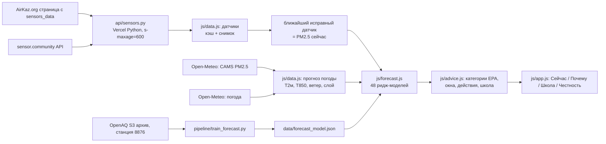

# Таза Тыныс — воздух у школы: сейчас и на 48 часов

**Кейс 1 «Экология Казахстана», Órleu Hack 2026.** Завуч выбирает школу на карте и видит реальный PM2.5 с ближайшего датчика (а не модельную цифру), прогноз на 48 часов от нашей модели, решение «физкультура на улице или в зале» по каждому уроку и готовое объявление для родителей на казахском и русском.

PWA без ключей: статический сайт + одна серверная функция `api/sensors.py`. Офлайн показывает последние сохранённые данные.

## Проблема

- В смоге Алматы **34%** загрязнения даёт сжигание угля и биомассы: **18%** ТЭЦ и котельные, **16%** отопление частного сектора; **32%** — дорожная пыль (цифры из кейса, Bizmedia).
- Популярные прогнозы опираются на глобальную модель Copernicus CAMS (сетка около 40 км). Она не видит смог в котловине: на реальной станции Алматы в 201 часе, когда та показывала больше 100 мкг/м³ (медиана 127), CAMS показывал медиану **40 — в 3,2 раза меньше** (`evals/forecast_report.md`).
- Завуч каждое утро решает «физкультура на улице или в зале» на глаз, а родители узнают о смоге из чатов.

## Что это и для кого

| Кому | Что получает | Экран |
|---|---|---|
| **Завуч (пользователь №1)** | Смена и расписание звонков (редактируются, сохраняются), отметка уроков физкультуры, решение «на улице / облегчённо / в зале» с причиной по категории US EPA AQI, объявление для родителей на kk и ru с копированием | «Школа» |
| Завуч, семьи | Реальный PM2.5 у выбранной точки (ближайший живой датчик), медиана по городу, сравнение «CAMS показывает M», прогноз на 48 ч, окна чистого воздуха, 3 действия на сейчас для профиля «обычный» или «чувствительная группа» | «Сейчас» |
| Все | Почему такой прогноз: инверсия (на 1,5 км теплее, чем у земли), ветер, слой перемешивания, вклад каждого признака | «Почему» |
| Частный сектор | Карточка «растопка сверху» с цифрой из рецензируемого исследования | «Почему» |
| Жюри и скептики | Ошибка нашего прогноза против «будет как сейчас» и CAMS, малая выборка на живых датчиках, источники и ограничения | «Честность» |

## Кейс → решение

| Требование кейса | Решение | Статус |
|---|---|---|
| «помогает людям жить с уже существующими экологическими проблемами» | Реальные датчики вместо модели, прогноз на 48 ч, режим завуча с объявлением родителям | готово |
| «снижает вред для природы» | Карточка «растопка сверху» для частного сектора (16% смога), с источником | готово |
| «Сферу, регион и пользователя команда выбирает сама» | Воздух, Алматы; завуч школы, семьи | готово |

## Демо за 90 секунд

Живые данные поздней осенью чистые, поэтому для показа смога есть зимний пример из архива: кнопка **«Зимний пример: смог 6 февраля 2025»** или `index.html?demo=winter`.

1. **Карта датчиков** («Сейчас»): цветные точки — живые датчики AirKaz и sensor.community, серые — молчат. Нажать на карту или выбрать район — это точка школы.
2. **«У вас сейчас N, Copernicus показывает M»**: в зимнем примере станция показывает **125 мкг/м³**, CAMS — **41**: «модель занижает в 3 раза».
3. **Лента 48 часов**: прогноз нашей модели по категориям EPA, зелёные точки — окна чистого воздуха; в зимнем примере серые точки показывают, что станция измерила на самом деле.
4. **«Почему»** → «Худший час прогноза»: инверсия +6,7 °C (на высоте 1,5 км теплее, чем у земли — «крышка»), ветер 1,3 м/с, слой перемешивания около 65 м; полоски вклада признаков.
5. **«Школа»**: 1 смена, физкультура 3-м уроком → «в зале: прогноз до 141 мкг/м³ (очень вредно)». Отметить ещё урок, открыть «Изменить расписание звонков». Объявление на русском и казахском, кнопки «Скопировать».
6. **«Честность»**: MAE 17,9 против 23,7 («будет как сейчас») и 22,7 (CAMS); в сильный смог модель ошибается сильнее, чем persistence, — сказано прямо.

## Запуск

```bash
cd projects/taza-tynys
python3 scripts/dev_server.py 8000   # http://localhost:8000 — статика + /api/sensors (как на Vercel)
```

`python3 -m http.server` тоже работает: без `/api/sensors` приложение берёт снимок `data/sensors_snapshot.json` (реальный, подписан датой). На Vercel `api/sensors.py` — Python serverless-функция, ответ кэшируется (`s-maxage=600`).

Проверки:

```bash
python3 scripts/check.py           # данные, кэш sw.js, внешние URL: клиент — только Open-Meteo, функция — только AirKaz и sensor.community
python3 tests/test_forecast.py     # прогноз: Python == JS (через JavaScriptCore), контракт, физическая проверка инверсии
python3 tests/test_app_logic.py    # логика на реальных снимках и зимнем архиве: датчик, окна, школа, категории EPA, офлайн-цепочка, ключи kk/ru
```

JS-тесты запускают настоящие модули из `js/` через `jsc` (JavaScriptCore в macOS); Node.js не нужен.

Пересборка данных (сеть нужна только здесь):

```bash
python3 pipeline/fetch_ground.py          # реальный PM2.5 (OpenAQ, станция 8876) + CAMS + погода с T850, окт 2024 – ноя 2025
python3 pipeline/train_forecast.py        # data/forecast_model.json, evals/forecast_report.md
python3 pipeline/make_snapshot.py         # data/snapshot.json — прогноз погоды и CAMS для офлайна
python3 pipeline/make_sensors_snapshot.py # data/sensors_snapshot.json — снимок датчиков
python3 pipeline/eval_small_sample.py     # evals/small_sample.md — малая выборка на живых датчиках и логе команды
python3 pipeline/make_demo_winter.py      # data/demo_winter.json — зимний пример
```

## Архитектура



- **Датчики:** AirKaz не отдаёт CORS, поэтому страницу читает серверная функция; она же берёт sensor.community. Датчик считается живым, если обновлялся за 3 часа; датчик с медианой за сутки ниже 1 мкг/м³ считаем неисправным (такой есть: «Ерменсай»).
- **Цепочки:** датчики `/api/sensors` → кэш (10 мин) → `data/sensors_snapshot.json`; прогноз Open-Meteo → кэш (3 ч) → `data/snapshot.json`. Офлайн: `sw.js` хранит статику, приложение — последний ответ.

## Где ИИ: прогноз на 48 часов на реальных измерениях

Отдельная ридж-регрессия на каждый горизонт h = 1…48 ч (numpy), таргет ln(1 + PM2.5), обратное преобразование с поправкой Дуана. Признаки: текущее измерение датчика, прогноз CAMS на час h, **инверсия** T(850 гПа) − T(2 м), ветер, час суток. Высоту слоя перемешивания пробовали: точности не добавила, знак коэффициента получался физически неверным — в модели её нет, в интерфейсе она справочная.

Обучение: октябрь 2024 – январь 2025; тест — **позже по времени**: февраль–март и октябрь–ноябрь 2025, только отопительный сезон. Станция OpenAQ 8876 (43,2529 с. ш., 76,9312 в. д.), открытый архив на S3 без ключа.

| Горизонт, ч | Наша модель, MAE | «Будет как сейчас» | CAMS |
|---|---|---|---|
| 1–6 | **13,1** | 14,7 | 22,5 |
| 7–12 | **17,7** | 23,8 | 22,6 |
| 13–24 | **18,0** | 23,4 | 22,7 |
| 25–48 | **19,2** | 26,1 | 22,7 |
| все 1–48 | **17,9** | 23,7 | 22,7 |
| только часы, где факт > 100 | 60,6 | **55,2** | 92,3 |

Решение «физкультура на улице?» (граница EPA 35,4 мкг/м³): наша модель права в **75%** часов, «будет как сейчас» — 70%, CAMS — 67%.

Честно: в сильный смог (факт > 100) модель ошибается меньше CAMS, но больше, чем «будет как сейчас»: длинные эпизоды она сглаживает. Соседние часы автокоррелированы, эффективный объём выборки ближе к числу суток. Модель обучена на одной станции, а в приложении стартует от дешёвых датчиков. Малая выборка на сегодняшних живых датчиках (`evals/small_sample.md`): «Жана Кайрат» — модель 19,3, persistence 24,5, CAMS 27,4; «Звездная поляна» — 9,5 / 10,0 / 15,5. Лог команды (`data-logs/airkaz`, раз в 10 минут) пока слишком короткий; скрипт подхватит его при следующем запуске.

Рекомендации — не генерация, а правила с источниками (ниже).

## Пороги и рекомендации

- Шкала — категории **US EPA AQI для PM2.5** (границы 2024 г.): хорошо ≤ 9,0; умеренно ≤ 35,4; вредно для чувствительных ≤ 55,4; вредно ≤ 125,4; очень вредно ≤ 225,4; опасно выше. Категории заданы для суточных значений, к часовым применяем как ориентир. Ориентир ВОЗ 2021 — 15 мкг/м³ за сутки.
- Советы по активности — переводы из EPA *Air Quality Guide for Particle Pollution* для двух профилей: «обычный» и «чувствительная группа» (дети, астма, болезни сердца и лёгких, беременность, пожилые). Своих медицинских формулировок нет.
- Школа — по таблице программы **EPA Air Quality Flag**: «вредно» и выше → тяжёлую нагрузку в помещение (в зал); «вредно для чувствительных» → на улице облегчённо, ученикам из чувствительной группы — короче и легче или в зале.
- **Растопка сверху:** Makonese T., Masekameni D.M., Annegarn H.J., Forbes P.B.C. *Emission factors of domestic coal-burning braziers*. South African Journal of Science, 2017, 113(3/4), doi:10.17159/sajs.2017/20160187: PM2.5 0,2–0,7 г/МДж при растопке сверху против 1,3–3,3 г/МДж снизу — до 80% меньше. В интерфейсе оговорка: измерено на жаровнях в ЮАР, не на казахстанских печах.

## Чем лучше существующих

| | IQAir, AirKaz | Таза Тыныс |
|---|---|---|
| Что показывают | Число сейчас; прогноз IQAir — модельный | Реальный датчик у вашей точки + прогноз на 48 ч, обученный на реальных измерениях, с честной ошибкой |
| Против CAMS | — | Показываем, во сколько раз CAMS ошибается прямо сейчас |
| Школа | Нет | Решение по каждому уроку физкультуры + объявление kk/ru |
| Почему | Нет | Инверсия, ветер, слой, вклад признаков |
| Снижение выбросов | Нет | «Растопка сверху» с источником |

Сильная сторона AirKaz и IQAir — их собственные сети датчиков; мы ими пользуемся и добавляем решение.

## Ограничения

- **Живых датчиков мало.** На странице AirKaz 153 записи о точках Алматы, но живые и исправные сейчас — единицы (25.11.2026: 2 у AirKaz + 3 у sensor.community; ещё один AirKaz застрял около нуля). Число «72 живых датчика» в первой проверке — это 3 датчика × 24 часовые строки. Ближайший датчик может быть в нескольких километрах — интерфейс об этом предупреждает.
- Дешёвые датчики без поверки, при высокой влажности завышают PM2.5; модель обучена на одной станции OpenAQ 8876, провайдер которой в архиве не указан.
- Архив OpenAQ для станции заканчивается в ноябре 2025; слой перемешивания в архиве погоды есть только с осени 2024 — отсюда короткий период обучения.
- В сильный смог модель сглаживает пики (см. таблицу).
- Казахский — на основных экранах и в объявлении; переведён с помощью ИИ, нужна вычитка носителем.
- Open-Meteo бесплатен для некоммерческого использования.

## Источники

- AirKaz.org (публичная страница `almaty.php`), sensor.community (`data.sensor.community`).
- OpenAQ, открытый архив на AWS S3 (`openaq-data-archive`, `locationid=8876`).
- Open-Meteo: Air Quality API (CAMS), Forecast и Historical Forecast API: https://open-meteo.com/en/docs
- US EPA: AQI для PM2.5 (2024), Air Quality Guide for Particle Pollution, Air Quality Flag Program: https://www.airnow.gov/air-quality-flag-program/
- WHO global air quality guidelines (2021): https://www.who.int/publications/i/item/9789240034228
- Makonese T. et al., 2017: https://doi.org/10.17159/sajs.2017/20160187

## Использованные инструменты

- Данные: AirKaz.org, sensor.community, OpenAQ, Open-Meteo (CAMS / Copernicus).
- Код: HTML, CSS, JavaScript (ES-модули) без фреймворков; Python 3.12 + numpy (модель), Pillow (иконки); JavaScriptCore (`jsc`) для тестов JS; Vercel Python runtime для `api/sensors.py`.
- ИИ-инструменты: Claude Code (Anthropic) — помощь в коде, текстах и казахском переводе; цифры проверены по источникам.

## Структура

```
index.html, styles.css, sw.js, manifest.webmanifest, icons/, vercel.json
api/       sensors.py (Vercel serverless: AirKaz + sensor.community)
js/        app.js (экраны), data.js (датчики, прогноз, кэш), forecast.js (модель), advice.js (EPA, окна, школа), i18n.js (ru, kk)
data/      forecast_model.json, snapshot.json, sensors_snapshot.json, small_sample.json, demo_winter.json
pipeline/  fetch_ground.py, forecast_features.py, train_forecast.py, eval_small_sample.py, make_*.py, history/ground_8876.json
evals/     forecast_report.md, small_sample.md
tests/     test_forecast.py, test_app_logic.py (+ JS-харнессы)
scripts/   check.py, dev_server.py
```
