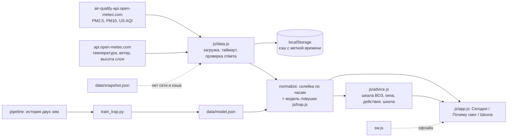

# Таза Тыныс — воздух Алматы по часам

**Кейс 1 «Экология Казахстана», Órleu Hack 2026.** Прогноз смога Алматы превращается в личный план по часам: когда проветривать, когда гулять с ребёнком, когда бегать. Для школы — инструмент завуча: физкультура на улице или в зале по каждому уроку, с причиной и готовым объявлением для родителей на казахском и русском.

PWA без сервера и без ключей: открывается в браузере телефона, работает офлайн, интерфейс на казахском и русском.

## Проблема

- В смоге Алматы **34%** загрязнения даёт сжигание угля и биомассы: **18%** ТЭЦ и котельные, **16%** отопление частного сектора; ещё **32%** — дорожная пыль (цифры из кейса, Bizmedia).
- Приложения показывают число («AQI 180»), но не отвечают на бытовые вопросы: открывать ли окно сейчас, вести ли ребёнка на площадку, отменять ли физкультуру на улице.
- Завуч каждое утро решает «физкультура на улице или в зале» на глаз, а родители узнают о смоге из чатов.

## Что это и для кого

| Кому | Что получает | Где в приложении |
|---|---|---|
| Семьи | План на сейчас (3 действия), шкала на 72 часа, окна чистого воздуха под профиль: взрослый, ребёнок, астма или сердце, бег и спорт, беременность | «Сегодня» |
| Все | Объяснение, почему будет смог: штиль, мороз, низкий слой перемешивания — с конкретными цифрами и вкладом каждого фактора | «Почему смог» |
| Школы (завуч) | Смена и расписание звонков (редактируются, сохраняются), отметка уроков физкультуры, решение «на улице / лёгкая нагрузка / в зале» с причиной, строже для 1–4 классов, объявление для родителей на kk и ru с копированием | «Школа» |
| Частный сектор | Карточка «растопка сверху»: бесплатный способ топить с меньшим дымом, цифра из рецензируемого исследования и честная оговорка | «Почему смог» |

## Кейс → решение

| Требование кейса | Решение | Статус |
|---|---|---|
| «помогает людям жить с уже существующими экологическими проблемами» | План по часам под профиль, окна чистого воздуха, школьный режим для завуча | готово |
| «снижает вред для природы» | Карточка «растопка сверху» для частного сектора (16% смога) с источником | готово |
| «Сферу, регион и пользователя команда выбирает сама» | Воздух, Алматы; семьи, школы, частный сектор | готово |

## Демо за 90 секунд

1. Открыть сайт → вкладка «Сегодня» с живым прогнозом. Нажать **«Зимний пример: смог 17 декабря 2025»** (или открыть `index.html?demo=winter`): реальный эпизод смога из архива Open-Meteo, показан так, будто сейчас утро 17 декабря. Сейчас PM2.5 = 72 мкг/м³, «в 4,8 раза выше суточного ориентира ВОЗ».
2. Профиль «Ребёнок»: «Не открывайте окна надолго. Лучшее время проветрить — 14:00», «Прогулка с ребёнком: лучше всего завтра 12:00–17:00», «С 09:00 ожидается смог». На шкале 72 часа видны зелёные точки окон и тёмные «крышки» часов погодной ловушки.
3. «Почему смог» → кнопка «Самый рискованный час: 20:00»: вероятность ловушки 53%, ветер слабее обычного, слой перемешивания около 56 м, вклад каждого фактора полосками. Ниже — карточка «растопка сверху» (до −80% PM2.5 по исследованию, с оговоркой).
4. «Школа»: 1 смена, 5–11 классы, физкультура 3-м уроком → «в зале: PM2.5 до 72 — выше порога 37,5». Переключить на 1–4 классы, отметить ещё урок, открыть «Изменить расписание звонков». Внизу — объявление для родителей на русском и казахском, кнопки «Скопировать».

## Запуск

```bash
cd projects/taza-tynys
python3 -m http.server 8000      # открыть http://localhost:8000
```

Сборки нет: чистые HTML, CSS и ES-модули. Для Vercel — статический проект, `vercel.json` отключает кэш для `sw.js` и `data/`.

Проверки:

```bash
python3 scripts/check.py          # данные, кэш sw.js, внешние URL только Open-Meteo
python3 tests/test_model.py       # модель: Python == JS (через JavaScriptCore)
python3 tests/test_app_logic.py   # логика на снимке и зимнем архиве: окна, действия, школа, офлайн-цепочка, ключи kk/ru
```

Тесты JS запускают настоящие модули из `js/` через `jsc` (JavaScriptCore, есть в macOS); Node.js не нужен.

Пересборка данных и модели (сеть нужна только здесь):

```bash
python3 pipeline/fetch_history.py     # две зимы, часовые данные Open-Meteo
python3 pipeline/train_trap.py        # data/model.json, evals/trap_report.md, tests/model_cases.json
python3 pipeline/make_snapshot.py     # data/snapshot.json — офлайн-фолбэк
python3 pipeline/make_demo_winter.py  # data/demo_winter.json — зимний пример
python3 pipeline/sensor_check.py      # evals/sensor_check.md — сверка с датчиками
python3 pipeline/make_icons.py        # PNG-иконки
```

## Архитектура



- **Цепочка данных:** живой Open-Meteo (таймаут 9 с, проверка формы ответа) → кэш в `localStorage` (до 3 часов считается свежим) → `data/snapshot.json` (снимок реального ответа API, подписан датой). Если данные не покрывают текущий час, приложение честно пишет «данные устарели» и показывает их с момента загрузки.
- **Офлайн:** `sw.js` кэширует оболочку, модули и данные (stale-while-revalidate, версионированный кэш).
- **Внешние запросы** только к `api.open-meteo.com` и `air-quality-api.open-meteo.com` (проверяет `scripts/check.py`). Шрифты системные, CDN нет.

## Где ИИ: модель погодной ловушки

Логистическая регрессия на numpy предсказывает вероятность того, что час попадёт в худшую пятую часть зимы по CAMS (PM2.5 > 45 мкг/м³). Признаки: средний ветер за 12 ч, средняя температура за сутки, средняя высота слоя перемешивания за 12 ч (в логарифме), час суток (две гармоники), выходной. Модель считается на устройстве (`js/trap.js`), формула продублирована на Python (`pipeline/trap_features.py`), совпадение до 1e-9 проверяет `tests/test_model.py`.

Обучение на одной зиме, тест на другой (ноябрь–февраль, по 2880 часов):

| Разбиение | Модель ROC-AUC (95% ДИ) | Только температура | Только час суток | AUC внутри часа | Precision | Recall |
|---|---|---|---|---|---|---|
| 2024/25 → 2025/26 | **0,841** (0,806–0,870) | 0,586 | 0,822 | 0,648 | 0,507 | 0,621 |
| 2025/26 → 2024/25 | **0,812** (0,772–0,854) | 0,625 | 0,786 | 0,580 | 0,439 | 0,726 |

Как читать честно (подробно — `evals/trap_report.md`):

- Большая часть AUC — суточный цикл: бейзлайн «только час» уже 0,79–0,82. Погода добавляет +0,02–0,03 общего AUC; внутри одного часа она различает «ловушку» и обычный вечер с AUC 0,58–0,65. Это объяснение и раннее предупреждение, а не прогноз концентраций.
- Соседние часы сильно автокоррелированы, поэтому доверительные интервалы считаются бутстрэпом **целыми сутками**, а обучение и тест разнесены на разные зимы.
- Таргет — реанализ CAMS, а не измерения датчиков.
- Зимы 2024/25 и 2025/26 вместо запланированных 2023/24 и 2024/25: высота слоя перемешивания в архиве Open-Meteo есть только примерно с осени 2024 года.

Рекомендации и тексты — правила на шаблонах (не генерация): пороги профилей, относительная шкала внутри дня и суточные ориентиры ВОЗ.

## Данные и ограничения CAMS

- Прогноз качества воздуха — модель **CAMS** (Copernicus) через Open-Meteo, сетка около 40 км. Она сглаживает смог в котловине: за две зимы медиана PM2.5 по CAMS около 30 мкг/м³, максимум около 110, тогда как городские датчики в морозные вечера, по сообщениям мониторинговых проектов, показывают кратно больше. Поэтому в интерфейсе стоит пометка «модель CAMS, занижает пики в котловине».
- Поэтому решения строятся по двум шкалам: **относительной** (самая чистая и самая грязная треть часов этого дня) и **абсолютной** — суточные ориентиры ВОЗ 2021 для PM2.5: AQG 15, IT-4 25, IT-3 37,5, IT-2 50, IT-1 75 мкг/м³ (применяем к часовым значениям как ориентир, с подписью).
- Пороги профилей (CAMS, мкг/м³): взрослый 50, ребёнок и спорт 37,5, астма/сердце и беременность 25 — консервативно из-за занижения пиков.
- **Сверка с реальными датчиками** (`evals/sensor_check.md`): архива реальных датчиков за прошлые зимы без регистрации найти не удалось (OpenAQ требует ключ, архив sensor.community из нашей сети недоступен). Сделали сверку за последние сутки с публичными AirKaz и sensor.community: в 4 точках из 5 датчики ниже CAMS, в одной (Жана Кайрат, север) — в 3,7 раза выше. Вывод: на уровне района CAMS ошибается в обе стороны, поэтому мы опираемся на относительную шкалу.

### Растопка сверху

Единственная карточка ветки «снижаем вред». Цифра — из рецензируемого исследования: Makonese T., Masekameni D.M., Annegarn H.J., Forbes P.B.C. *Emission factors of domestic coal-burning braziers*. South African Journal of Science, 2017, 113(3/4), doi:10.17159/sajs.2017/20160187. При растопке сверху (top-lit updraft) выбросы PM2.5 и PM10 на угольных жаровнях были 0,2–0,7 г/МДж против 1,3–3,3 г/МДж при обычной растопке снизу — до 80% меньше. В интерфейсе честно написано, что измерения сделаны в ЮАР на жаровнях-«имбаула», а не на казахстанских печах, и эффект может быть меньше.

Калькулятор выбросов частного дома был в первой версии и убран решением координатора (D12): коэффициенты выбросов имеют огромный разброс, расчёт не меняет решения людей и размывает продукт.

### Школьный режим: методика

Для каждого урока берётся худший час прогноза PM2.5 (CAMS) за время урока и сравнивается с промежуточными целями ВОЗ 2021 для суточного PM2.5:

| Классы | На улице | На улице, лёгкая нагрузка | В зале |
|---|---|---|---|
| 5–11 | PM2.5 ≤ 25 (IT-4) и нет погодной ловушки | 25 < PM2.5 ≤ 37,5 (IT-3), нет ловушки | PM2.5 > 37,5 или погодная ловушка |
| 1–4 | PM2.5 ≤ 25, нет ловушки и не самая грязная треть часов дня | — | всё остальное |

Строже для младших, потому что дети дышат чаще и вдыхают больше воздуха на килограмм веса (ВОЗ, *Air pollution and child health: prescribing clean air*, 2018). При погодной ловушке — всегда зал, потому что CAMS занижает пики. Мороз, ветер и осадки школа оценивает по своим правилам. Расписание звонков двух смен по умолчанию — пример, его можно поменять; всё хранится в `localStorage` устройства.

## Чем лучше существующих

| | IQAir, AirKaz | Таза Тыныс |
|---|---|---|
| Что показывают | Число PM2.5 / AQI сейчас и прогноз | План по часам: когда проветрить, когда гулять, когда тренироваться |
| Учёт человека | Общая шкала | Профили: ребёнок, астма/сердце, спорт, беременность |
| Школа | Нет | Инструмент завуча: смены, звонки, решение по урокам с причиной, объявление kk/ru |
| Почему смог | Нет | Модель погодной ловушки с вкладами факторов и метриками |
| Снижение выбросов | Нет | Совет «растопка сверху» для частного сектора с цифрой и источником |
| Без сети | Нужен интернет | Последний прогноз и снимок работают офлайн |

Сильная сторона IQAir и AirKaz — реальные датчики по районам; у нас прогноз CAMS по городу. Это наше главное ограничение (см. ниже).

## Ограничения

- Прогноз CAMS — один на весь город (сетка около 40 км), занижает зимние пики; района и двора он не различает.
- Модель ловушки обучена на реанализе CAMS двух зим; её погодная часть даёт умеренный прирост к суточному циклу.
- Правила профилей опираются на рекомендации ВОЗ, но это не медицинская консультация.
- Эффект «растопки сверху» измерен на жаровнях в ЮАР; для печей Алматы он может быть меньше.
- Казахский интерфейс переведён с помощью ИИ, нужна вычитка носителем.
- Open-Meteo бесплатен для некоммерческого использования; для коммерческого нужна платная лицензия.

## Источники

- Open-Meteo Air Quality API (CAMS): https://open-meteo.com/en/docs/air-quality-api ; Weather / Historical Forecast API: https://open-meteo.com/en/docs
- WHO global air quality guidelines (2021): https://www.who.int/publications/i/item/9789240034228
- WHO. Personal interventions and risk communication on air pollution (2020): https://www.who.int/publications/i/item/9789240000278
- WHO. Air pollution and child health: prescribing clean air (2018), документ WHO/CED/PHE/18.01
- Makonese T. et al. Emission factors of domestic coal-burning braziers. S Afr J Sci. 2017;113(3/4): https://doi.org/10.17159/sajs.2017/20160187
- AirKaz.org (публичная карта датчиков), sensor.community (открытые датчики) — только для сверки.

## Использованные инструменты

- Данные: Open-Meteo (CAMS, архив прогнозов погоды), AirKaz.org, sensor.community.
- Код: HTML, CSS, JavaScript (ES-модули) без фреймворков; Python 3.12 + numpy (обучение модели), Pillow (иконки); JavaScriptCore (`jsc`) для тестов JS.
- ИИ-инструменты: Claude Code (Anthropic) — помощь в написании кода, текстов и казахского перевода; все цифры проверены по источникам выше.

## Структура

```
index.html, styles.css, sw.js, manifest.webmanifest, icons/
js/        app.js (интерфейс), data.js (загрузка и кэш), trap.js (модель), advice.js (правила и школьный режим), i18n.js (kk/ru)
data/      model.json, snapshot.json, demo_winter.json
pipeline/  fetch_history.py, train_trap.py, trap_features.py, make_snapshot.py, make_demo_winter.py, sensor_check.py, make_icons.py, history/
evals/     trap_report.md, sensor_check.md
tests/     test_model.py, test_app_logic.py (+ JS-харнессы)
scripts/   check.py
```
