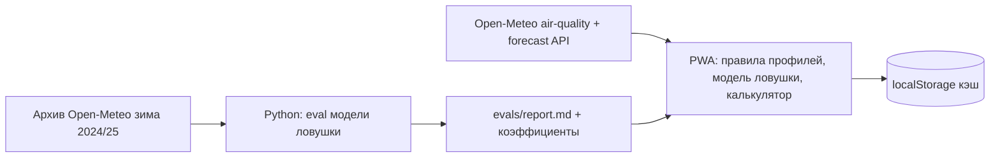

# Таза Тыныс: SPEC
**Кейс:** 1. Экология Казахстана (воздух). **Одной фразой:** для жителей Алматы прогноз смога превращается в личный план по часам (когда проветривать, гулять с ребёнком, бегать, проводить физкультуру на улице), а для частных домов есть калькулятор «сколько смога даёт моя печь и что выгоднее поменять».

## Plan-note
- **Идея:** берём почасовой прогноз PM2.5 и PM10 на 3 дня (Open-Meteo, модель CAMS, без ключа) и погоду (температура, ветер, высота слоя перемешивания). Модель «погодной ловушки» объясняет, почему будет смог (штиль + мороз + низкий слой = отопительный смог), и для выбранного профиля (ребёнок, астма, бег, беременность, школа) строит план по часам: зелёные окна для проветривания и прогулки, красные часы. Второй экран для частного сектора: тип отопления и объём угля → выбросы PM2.5 за сезон в понятных эквивалентах → сравнение газ / электричество / утепление по деньгам и выбросам.
- **Плюсы:** закрывает обе ветки задачи («жить с уже существующими проблемами» и «снижает вред»); живые данные; бьёт в главный пункт контекста (34% уголь и биомасса, из них 16% частный сектор).
- **Минусы и риски:** тема воздуха популярна; CAMS прогнозирует на уровне города, а не района; коэффициенты выбросов печей приблизительные (берём из литературы и честно указываем источник).

## Проблема
- В смоге Алматы 34% загрязнения даёт сжигание угля и биомассы: 18% ТЭЦ и котельные, 16% отопление частного сектора; 32% дорожная пыль (кейс).
- Люди видят «AQI 180», но не понимают, что делать сегодня: когда открыть окно, вести ли ребёнка на площадку, отменять ли физкультуру на улице.
- Частный дом с угольной печью не видит, сколько он добавляет и сколько стоит альтернатива.

## Решение
- **Житель:** профиль → «Сегодня»: светофор по часам, окна чистого воздуха, 3 действия на сегодня; «Почему смог»: объяснение по погоде; прогноз на 3 дня.
- **Школа:** режим «Физкультура/прогулка на улице» по урокам (8:00–15:00), да или нет, текст объявления для родителей.
- **Частный дом:** калькулятор печи → выбросы за сезон в эквивалентах → сравнение вариантов (газ, электрокотёл, утепление) по тенге в год и снижению выбросов.
- Офлайн: последний прогноз кэшируется, видна метка «данные от 14:05».

## Демо-сценарий (90 секунд)
1. Открыть сайт: живой прогноз Алматы, сейчас «PM2.5 = 87 мкг/м³, в 5,8 раза выше нормы ВОЗ (15 мкг/м³, суточная)».
2. Профиль «Ребёнок 6 лет»: «Окно прогулки 13:00–15:00. Проветрить сейчас нельзя, лучше в 14:00. Вечером с 19:00 смог до утра».
3. «Почему смог сегодня»: штиль 1 м/с, −8 °C, слой перемешивания 180 м, «город под крышкой, топят печи».
4. Режим школы: «Физкультура на улице: 1–3 уроки нет, 5–6 да».
5. Калькулятор печи: 4 т угля за зиму = N кг PM2.5 = «как X машин за год»; газ дешевле на Y ₸ в год и даёт −Z% выбросов.

## Требования кейса → как закрываем
| Требование (цитата) | Решение | Статус |
|---|---|---|
| «помогает людям жить с уже существующими экологическими проблемами» | План по часам под профиль, школьный режим | план |
| «снижает вред для природы» | Калькулятор частного дома: рычаг снижения 16% выбросов | план |
| «Сферу, регион и пользователя команда выбирает сама» | Воздух, Алматы, семьи, школы, частный сектор | план |

## Скоуп
- **MUST:** живой прогноз Open-Meteo (PM2.5, PM10, US AQI + погода: температура, ветер, boundary_layer_height) на 3 дня; профили и правила; часовая шкала-светофор и окна; «почему смог» (модель погодной ловушки); школьный режим; калькулятор печи с указанием источников коэффициентов; кэш офлайн; kz/ru интерфейс.
- **SHOULD:** валидация модели ловушки на истории (архив Open-Meteo за зиму 2024/25: насколько правило «штиль + мороз + низкий слой» предсказывает часы PM2.5 > 55), отчёт в `evals/`; ретроспектива «вчера».
- **COULD:** другие города (Астана, Караганда, Шымкент) переключателем.
- **WON'T:** собственные датчики, аккаунты, пуш-уведомления.

## Архитектура

## AI-часть
- Модель «погодной ловушки» — простая обученная модель (логистическая регрессия или дерево глубины ≤3) на исторических часовых данных Алматы: признаки ветер, температура, слой перемешивания, час, день недели → вероятность часа «PM2.5 > 55». Обучаем в Python, коэффициенты кладём в JSON, предсказание на устройстве. Важно: таргет — это реанализ CAMS, а не датчики (честно пишем).
- Тексты объяснений и рекомендаций по шаблонам, проверены по рекомендациям ВОЗ.

## Как измеряем качество
- ROC-AUC и precision/recall модели ловушки на отложенной зиме против бейзлайна «только температура».
- Совпадение «зелёных окон» с фактическими часами PM2.5 < 35 в истории.

## Стоимость и масштаб
- Алматы около 2,3 млн жителей (*гипотеза, уточнить*); около 150 тыс. частных домов с твёрдым топливом (*гипотеза, проверить*). Хостинг статики почти бесплатный, API Open-Meteo бесплатный для некоммерческого использования (для коммерческого нужна платная лицензия).

## Риски и план Б
- API недоступен → встроенный снимок прогноза с пометкой «демо-данные».
- Модель ловушки слабая → показываем правило с честными метриками.

## Контрольные точки
- КТ-1 25.11 20:00: живой прогноз и шкала-светофор.
- КТ-2 26.11 14:00: профили, «почему», школа, калькулятор, деплой.
- КТ-3 26.11 22:00: eval модели, ревью, полировка.
